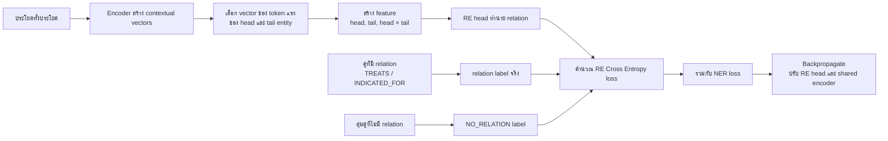
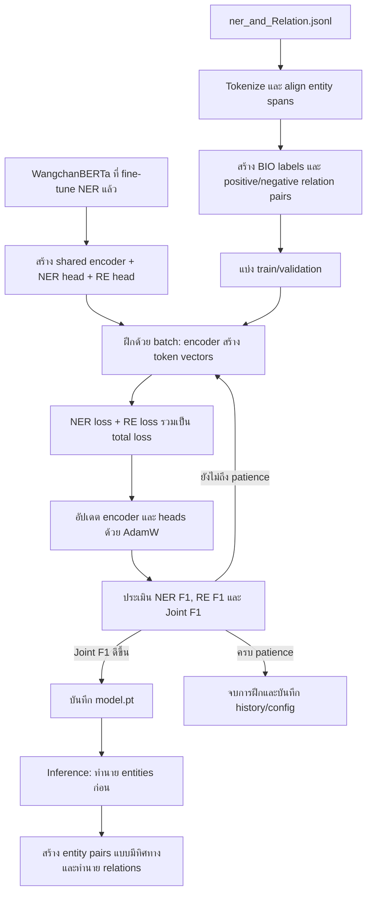

# Multi-Task Learning: NER + Relation Extraction

เอกสารนี้สรุปวิธีฝึกโมเดลจากโค้ดและไฟล์คอนฟิกในโปรเจกต์ โดยโมเดลเรียนรู้สองงานจากข้อความชุดเดียวกันพร้อมกัน:

1. **Named Entity Recognition (NER)** ระบุช่วงข้อความที่เป็นชื่อยา (`DRUG`), โรค (`DISEASE`) และอาการ (`SYMPTOM`)
2. **Relation Extraction (RE)** จำแนกความสัมพันธ์แบบมีทิศทางระหว่าง entity เช่น ยา `TREATS` โรค หรือยา `INDICATED_FOR` อาการ

## ไฟล์ที่เกี่ยวข้อง

| ไฟล์ | หน้าที่ |
|---|---|
| `configs/mtl_config.yaml` | กำหนดโมเดลตั้งต้น ชุดข้อมูล labels และ hyperparameters |
| `data/processed/ner_and_Relation.jsonl` | ตัวอย่างฝึก แต่ละบรรทัดมีข้อความ, entity spans และ relations ที่อ้าง entity ด้วย index |
| `src/data/mtl_dataset.py` | tokenize ข้อความ, จัด labels ให้ token และสร้าง relation pairs |
| `src/models/mtl_model.py` | shared encoder และหัวทำนาย NER/RE พร้อมคำนวณ loss รวม |
| `src/training/mtl_trainer.py` | training loop, validation metrics และบันทึก checkpoint |
| `scripts/train_mtl.py` | ประกอบส่วนต่าง ๆ และรันการฝึก |
| `scripts/inference_mtl.py` | โหลด checkpoint และทำนาย entity/relations จากข้อความใหม่ |
| `outputs/mtl_model/` | checkpoint, tokenizer, label config และประวัติการฝึกที่บันทึกไว้ |

## ข้อมูลที่ใช้สอน

คอนฟิกเลือก `outputs/fl_ner_model_round10` เป็น base model ซึ่งเป็น SapBRTa ที่ผ่านการ fine-tune งาน NER มาแล้ว จากนั้นนำ encoder มาใช้เป็นจุดเริ่มต้นของโมเดลสองงาน ข้อมูลฝึกอยู่ใน `ner_and_Relation.jsonl` โดยตัวอย่างหนึ่งมีรูปแบบหลักประมาณนี้:

```json
{
  "text": "...",
  "entities": [
    {"start": 0, "end": 12, "label": "DRUG", "text": "..."},
    {"start": 22, "end": 35, "label": "DISEASE", "text": "..."}
  ],
  "relations": [
    {"head": 0, "tail": 1, "type": "TREATS"}
  ]
}
```

`start` และ `end` เป็นตำแหน่งตัวอักษร โดยช่วง entity ใช้แบบครึ่งเปิด `[start, end)` ส่วน `head` และ `tail` ใน relation เป็น index ของ entity ในรายการ `entities` ตัวอย่างข้อมูลจริงมีทั้ง relation `TREATS` และ `INDICATED_FOR`.

## วิธีที่โมเดลเรียนรู้

### 1. ใช้ encoder ร่วมกัน

ข้อความถูกส่งเข้า encoder หนึ่งครั้งเพื่อสร้าง vector ของแต่ละ token จากนั้นส่งต่อให้หัวทำนายสองชุด:

- **NER head:** ชั้น linear จำแนก BIO tag ของแต่ละ token ได้แก่ `O`, `B-DRUG`, `I-DRUG`, `B-DISEASE`, `I-DISEASE`, `B-SYMPTOM`, `I-SYMPTOM`
- **RE head:** ใช้ vector ของ token แรกใน entity ฝั่ง head และ tail มาสร้าง feature `[head, tail, head × tail]` แล้วจำแนกเป็น `NO_RELATION`, `TREATS` หรือ `INDICATED_FOR`

การใช้ encoder ร่วมกันทำให้สัญญาณจากทั้งสองงานปรับ representation เดียวกันได้ ในคอนฟิกกำหนด `freeze_encoder: false` แต่สคริปต์ปัจจุบันไม่ได้อ่านค่านี้มา freeze พารามิเตอร์ ดังนั้นพฤติกรรมจริงคือฝึก encoder และหัวทำนายทั้งหมดร่วมกัน

### 2. แปลงข้อมูลเป็น labels และคู่ relation

`MTLDataset` ทำงานกับข้อมูลแต่ละตัวอย่างดังนี้:

1. Tokenize ข้อความด้วย tokenizer ของ base model จำกัดความยาวไม่เกิน 256 tokens และขอ character offsets กลับมาด้วย
2. ใช้ character spans ของ entities จัด BIO labels ให้ tokens โดย special tokens และตำแหน่ง padding ได้ label `-100` เพื่อไม่ให้คิด loss
3. แปลงจุดเริ่มต้นของแต่ละ entity เป็นตำแหน่ง token แรก เพื่อใช้เป็นตัวแทน entity ในงาน RE
4. สร้าง **positive pairs** จาก relations ในข้อมูล และสุ่ม **negative pairs** ที่ไม่มี relation กำกับ สูงสุด 10 คู่ต่อตัวอย่าง แล้วติด label `NO_RELATION`
5. หาก entity ถูกตัดออกจากข้อความเพราะถึงขีดจำกัดความยาว จะไม่ใช้ relation pair ที่อ้าง entity นั้น

Collate function pad ข้อความใน batch ให้ยาวเท่ากัน และรวม relation pairs พร้อมเก็บ index ว่าแต่ละ pair มาจากตัวอย่างใด

### 3. คำนวณ loss ของสองงานพร้อมกัน

NER ใช้ Cross Entropy โดยข้ามตำแหน่ง `-100`; RE ใช้ Cross Entropy กับ relation labels จากนั้นรวมเป็น loss เดียว:

```text
total_loss = lambda_ner × ner_loss + lambda_re × re_loss
```

ค่าตั้งต้นของทั้ง `lambda_ner` และ `lambda_re` เท่ากับ `1.0` จึงให้น้ำหนัก loss สองงานเท่ากันตามคอนฟิก ใช้ AdamW, learning rate `2e-5`, weight decay `0.01`, gradient clipping ที่ `1.0` และ learning-rate schedule แบบ warmup แล้ว linear decay

### RE ใช้บริบทของประโยคอย่างไร

การฝึก RE ในโค้ดทำงานเป็นลำดับ 5 ขั้นตอนดังนี้:

1. **Encoder อ่านทั้งประโยค:** `JointNERAndREModel.forward()` ส่ง token ทั้งประโยคและ `attention_mask` เข้า encoder เพื่อสร้าง `last_hidden_state` ซึ่งเป็น contextual vector ของแต่ละ token ที่อาศัยบริบทจากทั้งด้านซ้ายและด้านขวา
2. **เลือกตัวแทน entity:** `MTLDataset` ใช้ character offsets หา token ที่ครอบตำแหน่งเริ่มต้นของแต่ละ entity แล้วส่งคู่ตำแหน่ง `(head_token, tail_token)` พร้อม index ของตัวอย่างใน batch
3. **สร้าง feature ของคู่:** `_compute_re_logits()` ดึง vector ของ token แรกใน head และ tail แล้วประกอบเป็น `[h_head ; h_tail ; h_head ⊙ h_tail]` จากนั้น RE head (linear layer) ทำนาย `NO_RELATION`, `TREATS` หรือ `INDICATED_FOR`
4. **คำนวณ RE loss:** relation ที่ระบุในข้อมูลเป็น positive pair ส่วนคู่ที่ไม่มี relation จะถูกสุ่มมาได้สูงสุด 10 คู่ต่อตัวอย่างและติดป้าย `NO_RELATION` จากนั้นใช้ Cross Entropy เปรียบเทียบผลทำนายกับ label
5. **ปรับโมเดล:** RE loss ถูกรวมกับ NER loss เป็น `total_loss` แล้ว backpropagate เพื่อปรับน้ำหนัก RE head และ shared encoder ร่วมกัน (โดยมี `lambda_re` และ `lambda_ner` ควบคุมน้ำหนักแต่ละ loss)

มองเป็น flow สั้น ๆ ได้แบบนี้:



**สรุปในประโยคเดียว:** encoder อ่านประโยค → ใช้ vector ของ entity สองฝั่งทำนายความสัมพันธ์ → เทียบกับ label จริง → ใช้ loss ปรับโมเดล

สรุปคือ RE ใช้ vector ของ token แรกของ entity ซึ่ง encoder สร้างจากบริบททั้งประโยค ไม่ได้ใช้เพียงหน้าต่างคำใกล้ entity แต่ก็ไม่ได้ pool vector ทุก token ในช่วง entity หรือเพิ่ม feature ระยะห่างระหว่าง entity แยกต่างหาก

### 4. แบ่งข้อมูล ตรวจผล และเลือก checkpoint

สคริปต์แบ่งข้อมูลเป็น train/validation ด้วยสัดส่วน validation `20%` และ seed `42` จากนั้นฝึก batch size `8` (ตั้ง epochs ไว้ `30` ในคอนฟิก) และประเมินหลังจบแต่ละ epoch:

- **NER F1:** วัดระดับ entity span จาก BIO sequences โดยต้องตรงทั้งขอบเขตและชนิด entity
- **RE F1:** วัดระดับ relation pair โดยไม่นับ `NO_RELATION` เป็น positive class
- **Joint F1:** ค่าเฉลี่ยของ NER F1 และ RE F1 ใช้เลือก checkpoint และพิจารณา early stopping

ถ้า Joint F1 ดีขึ้น จะเขียน weights ลง `outputs/mtl_model/model.pt` เมื่อไม่ดีขึ้นต่อเนื่องถึง patience (`15` epochs) จะหยุดฝึก `training_history.json` เก็บ loss และ metrics ราย epoch ส่วน `label_config.json` เก็บ labels และ base model path ที่ inference ใช้

> หมายเหตุ: `fp16`, `freeze_encoder` และค่าบางส่วนในส่วน logging ของ YAML มีระบุไว้ แต่ training script ปัจจุบันไม่ได้ใช้ค่าเหล่านั้นโดยตรง

## ลำดับการทำงาน (Flow)



## ใช้งาน

เริ่มฝึกจาก root ของโปรเจกต์:

```bash
python scripts/train_mtl.py
```

กำหนด config หรือ override ค่าบางอย่างได้ เช่น:

```bash
python scripts/train_mtl.py --config configs/mtl_config.yaml --epochs 20 --batch-size 8
```

รัน inference กับข้อความใหม่:

```bash
python scripts/inference_mtl.py \
  --model outputs/mtl_model \
  --text "ลอราทาดีน ใช้บรรเทาอาการของโรคภูมิแพ้" \
  --threshold 0.5
```

Inference ใช้ NER หา entities ก่อน แล้วสร้างคู่ entity ทุกคู่ที่มีทิศทางเพื่อให้ RE head ทำนาย จากนั้นคืนข้อความ entity และ relation เป็น JSON

## ผลการฝึกที่มีอยู่ในโปรเจกต์

`outputs/mtl_model/training_history.json` มีข้อมูล 35 epochs โดย Joint F1 สูงสุดที่บันทึกไว้คือ epoch 20: NER F1 `0.9507`, RE F1 `0.9672`, Joint F1 `0.9590` ค่าเหล่านี้เป็นผลบน validation split ที่สคริปต์สร้างจากชุดข้อมูลเดียวกัน ไม่ใช่ผลทดสอบบน test set แยกต่างหาก
